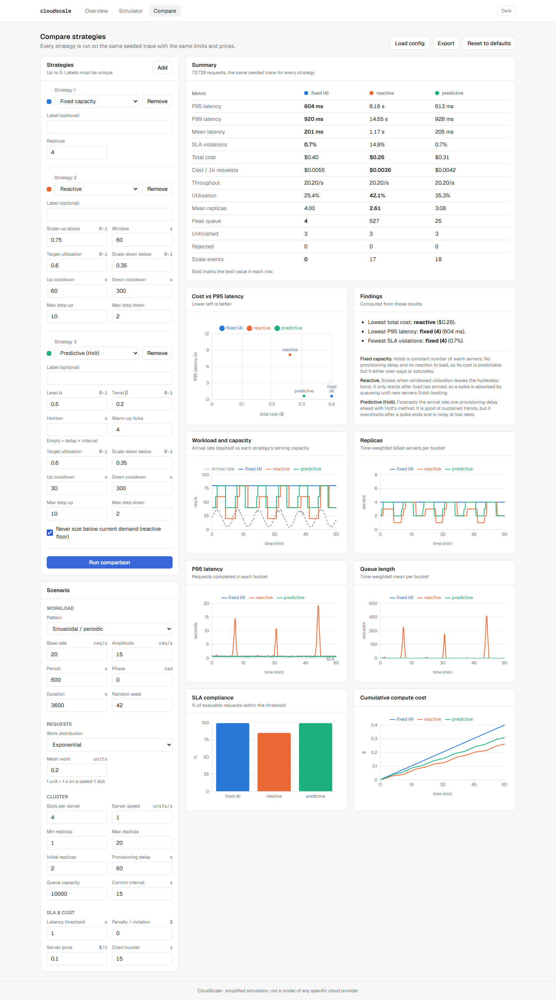
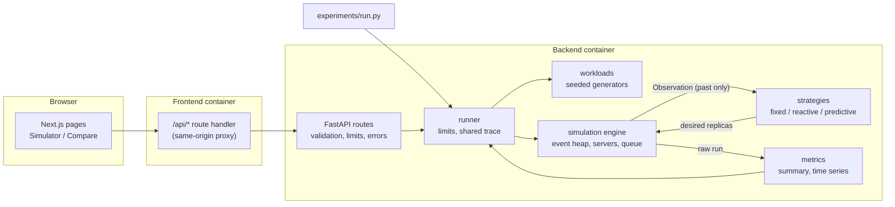
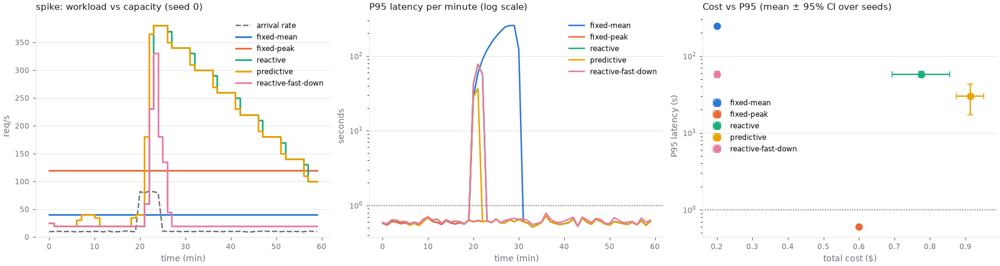
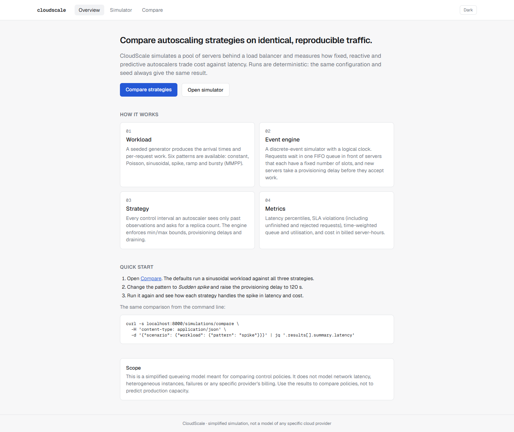
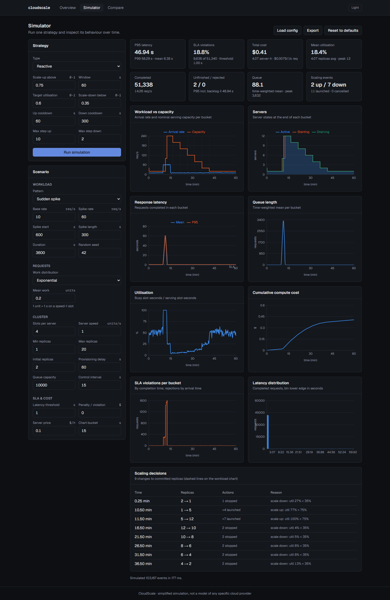

# CloudScale

A deterministic discrete-event simulator for comparing cloud autoscaling strategies.
You give it a traffic pattern, a cluster and an SLA. It runs fixed, reactive and
predictive autoscalers against the *same* seeded request trace and reports latency
percentiles, SLA violations, utilisation and cost, with a FastAPI backend and a Next.js
dashboard on top.



> **Scope.** This is a simplified queueing model for comparing control policies. It is
> not a model of AWS, GCP or any real provider. See [Known limitations](#known-limitations).

## The problem

An autoscaler trades money for latency: provision too little and requests queue past the
SLA, provision too much and you pay for idle servers. Which policy wins depends on the
traffic shape and on how long new servers take to boot, and that is hard to judge on real
infrastructure. Experiments there are slow, cost money and can't be repeated, because
production traffic never arrives the same way twice.

CloudScale makes the comparison a controlled experiment. Every strategy sees exactly the
same seeded request trace, so differences in the results come from the policy alone. The
benchmarks also show where the "smart" strategy loses.

## Features

- **Discrete-event engine**: logical clock, explicit tie-breaking, FIFO queue in front
  of multi-slot servers, provisioning delays, draining scale-down, queue backpressure.
  Every request ends `COMPLETED`, `REJECTED` or `UNFINISHED`; none are dropped silently.
- **Six seeded workloads**: constant, Poisson, sinusoidal, spike, ramp, bursty (MMPP).
  The same config and seed always give bit-identical traces.
- **Three strategies behind one interface**: fixed capacity; reactive (utilisation
  thresholds with hysteresis, cooldowns and target-tracking sizing); predictive (Holt
  double exponential smoothing over the provisioning horizon).
- **No future-data leakage**: strategies only receive an immutable snapshot of past
  aggregates. There is a test that proves it.
- **Honest metrics**: time-weighted averages, P95/P99, and backlog-aware lower-bound
  percentiles so a strategy can't look fast by never finishing its slow requests.
- **REST API** with validation, cost limits, a body-size limit, bounded concurrency and
  a versioned result schema.
- **Dashboard** with simulator and comparison views, dark mode, JSON/CSV export and
  config import.
- **Reproducible benchmarks**: 6 scenarios × 5 seeds, with 95% CIs. CI checks that the
  results reproduce.

## Stack

| Layer | Tools |
|---|---|
| Simulation + API | Python 3.12, NumPy, Pydantic v2, FastAPI, Uvicorn |
| Quality | pytest, Hypothesis, Ruff, mypy `--strict` |
| Frontend | Next.js 16 (App Router), React 19, TypeScript strict, Tailwind CSS 4, Recharts, Vitest + Testing Library |
| Infra | Docker, Docker Compose, GitHub Actions |

## Architecture



```
backend/app/
  workloads/   config models + vectorised NumPy generators
  simulation/  scenario config, entities (lifecycles), engine, runner
  strategies/  Observation/Decision interface, fixed, reactive, predictive
  metrics/     result schemas + computation from raw engine output
  api/         FastAPI schemas, routes, error handlers, body-size middleware
frontend/
  app/         pages (/, /simulate, /compare) and the /api proxy route
  components/  forms, charts, comparison table, export
  hooks/ lib/  API client, validation, data transforms
experiments/   benchmark suite, results, charts
docs/          simulation model, ADRs, screenshots
```

The simulation core imports nothing from FastAPI or Starlette, and a test enforces it.
Design decisions are recorded in [docs/adr](docs/adr):

1. [Discrete-event simulation instead of time steps](docs/adr/0001-discrete-event-simulation.md)
2. [Past-only observations; the engine enforces physical constraints](docs/adr/0002-past-only-observations.md)
3. [Stateless synchronous API with shared schemas](docs/adr/0003-stateless-api-shared-schemas.md)
4. [How unfinished and rejected requests enter the metrics](docs/adr/0004-unfinished-requests-in-metrics.md)

## Running locally

Requirements: Python 3.12, 3.13 or 3.14, and Node.js 20.9+ (22 LTS recommended).
CI runs on Linux and Windows.

**Backend**, macOS / Linux:

```bash
cd backend
python3 -m venv .venv && source .venv/bin/activate
pip install -r requirements-dev.txt -c constraints.txt
pip install --no-deps -e .
uvicorn app.main:app --reload --port 8000
```

**Backend**, Windows (PowerShell). Calling the venv's Python directly avoids the
execution-policy prompt that `Activate.ps1` can trigger:

```powershell
cd backend
python -m venv .venv
.venv\Scripts\python -m pip install -r requirements-dev.txt -c constraints.txt
.venv\Scripts\python -m pip install --no-deps -e .
.venv\Scripts\python -m uvicorn app.main:app --reload --port 8000
```

**Frontend**, in a second terminal (same on every OS):

```bash
cd frontend
npm ci
npm run dev        # http://localhost:3000, proxies /api to http://localhost:8000
```

Set `CLOUDSCALE_API_URL` to point the frontend at a different backend.

### Try it

1. Open <http://localhost:3000/compare> and press **Run comparison** to compare the
   default fixed, reactive and predictive strategies on a sinusoidal workload.
2. Press **Load config** and pick any `experiments/results/<scenario>/config.json`
   (`spike`, `bursty`, `periodic`, `ramp`, `constant`, `overload`). This loads the exact
   scenario and strategies from the benchmark suite. Running it reproduces that
   benchmark's seed-0 numbers in `runs.csv`, and a test checks this for the spike
   scenario.
3. Open **Simulator** to run one strategy and inspect it over time: every scaling
   decision with its reason, server states, queue, utilisation, latency and cost.

### Docker

```bash
docker compose up --build
```

The frontend is on <http://localhost:3000> and the API on <http://localhost:8000>
(OpenAPI docs at `/docs`). The backend image runs as a non-root user with a
healthcheck, and the frontend waits for it to become healthy.

## API

Interactive docs are at `http://localhost:8000/docs`.

| Method | Path | Purpose |
|---|---|---|
| GET | `/health` | liveness, version, result schema version |
| GET | `/strategies` | strategy types, descriptions, JSON schema and defaults |
| GET | `/config/defaults` | default scenario, strategies, workload patterns, limits |
| POST | `/simulations/run` | `{scenario, strategy}` → one `SimulationResult` |
| POST | `/simulations/compare` | `{scenario, strategies[1..5]}` → every strategy on one shared trace |

```bash
curl -s localhost:8000/simulations/compare -H 'content-type: application/json' -d '{
  "scenario": {"duration_s": 1800, "seed": 7,
               "workload": {"pattern": "spike", "base_rate": 10, "spike_rate": 80,
                            "spike_start_s": 600, "spike_duration_s": 300}},
  "strategies": [{"type": "fixed", "replicas": 6}, {"type": "reactive"}, {"type": "predictive"}]
}' | jq '.results[] | {label: .strategy.label, p95: .summary.latency.p95_s, cost: .summary.total_cost}'
```

All omitted fields take their defaults. Results contain `schema_version` (`1.0`), a
summary, a column-oriented time series (with raw integrals so every chart can be
recomputed), every scaling decision with its reason, a latency histogram and runtime
stats.

**Errors** always have the shape `{"error": code, "message": str, "details": [...]}`:

| Status | `error` | When |
|---|---|---|
| 422 | `validation_error` | schema/range/consistency checks (e.g. `min_replicas > max_replicas`) |
| 422 | `invalid_configuration` | valid parts that don't fit together (fixed replicas outside bounds) |
| 422 | `limit_exceeded` | expected requests > 1M per run or 2.5M per comparison, or peak rate × duration > 5M (checked before generating anything) |
| 422 | `simulation_too_expensive` | the 30 s wall-clock budget was hit |
| 413 | `payload_too_large` | body > 64 KiB (checked even without `Content-Length`) |
| 503 | `server_busy` | all simulation slots busy; includes `Retry-After` |
| 500 | `internal_error` | generic message only; the traceback is logged server-side |

## Simulation methodology

The full specification, with lifecycles, event ordering, formulae and edge cases, is in
**[docs/simulation-model.md](docs/simulation-model.md)**. In short:

- **Units.** Seconds of simulated time; work units, where 1 unit = 1 s on one slot at
  `server_speed = 1`; prices per server-hour.
- **Service.** One global FIFO queue. Each server has `slots_per_server` slots, and each
  slot runs one request for `work / speed` seconds. Dispatch goes to the
  lowest-numbered active server with a free slot.
- **Time.** The simulation covers `[0, T)`. Simultaneous events are ordered
  `SAMPLE < COMPLETION < SERVER_READY < ARRIVAL < CONTROL`, with FIFO within a kind.
- **Scaling.** Every `control_interval_s` the strategy returns desired committed replicas
  (active + starting). The engine clamps to `[min, max]`. It scales up by reusing
  draining servers before launching new ones (which become ready after
  `provisioning_delay_s`). It scales down by cancelling booting servers first, then
  stopping idle servers, then draining busy ones.
- **Billing.** Servers are billed while starting, active or draining, per second.
- **SLA.** Violations = completed requests over the threshold + unfinished requests
  already older than the threshold + rejected requests. Unfinished requests younger than
  the threshold are reported as *undetermined*.

## Scaling algorithms

**Fixed.** A constant number of warm replicas from `t = 0`.

**Reactive.** Over a sliding window it computes time-weighted utilisation `U` and mean
busy slots `B̄`. If `U > upper` and the cooldown has passed, it scales up to
`⌈(B̄ + backlog) / (target × slots)⌉`, where
`backlog = queue × service_estimate / backlog_drain_s`. Booting servers count towards
capacity, so it doesn't double-scale. If `U < lower`, the queue is empty, nothing is
booting and the scale-down cooldown has passed, it removes at most `max_step_down`
replicas. The gap between `lower` and `upper` is the hysteresis band.

**Predictive.** Holt's linear trend method on the per-interval arrival rate:

```
level_t = α·r_t + (1−α)(level_{t−1} + trend_{t−1})
trend_t = β·(level_t − level_{t−1}) + (1−β)·trend_{t−1}
forecast(h) = max(0, level_t + trend_t · h/Δ),   h = provisioning delay + control interval
```

Capacity follows Little's law: `forecast × service_estimate / target` slots. An
optional reactive floor stops it from going below what the current interval actually
needs. It scales down only when the forecast utilisation drops below `lower_threshold`.

## Benchmarks

Run these from the repository root with the backend's virtualenv (on Windows:
`backend\.venv\Scripts\python experiments\run.py`):

```bash
python experiments/run.py            # full suite: 6 scenarios × 5 seeds, ~40 s
python experiments/run.py --check    # quick suite; fails if results differ from the committed digest
```

A rerun of the full suite on the machine that produced the committed results rewrites
`experiments/results` byte for byte, charts included, so `git status` stays clean. On
other machines the numbers match (CI checks the digest on Linux and Windows), but the
PNGs can differ slightly because of font rendering.

Each scenario writes `config.json` (the exact scenario, strategies and seeds),
`runs.csv` (one row per seed × strategy), `summary.json` (mean, SD, 95% CI, min, max)
and `overview.png`. The full tables are in
[experiments/results/REPORT.md](experiments/results/REPORT.md).

Setup: 4 slots per server, exponential work with mean 0.2 (≈ 20 req/s per server),
60 s provisioning delay, 1 s SLA, $0.10 per server-hour, 1 h runs. `fixed-mean` and
`fixed-peak` are static fleets sized for the mean and peak *intended* rate at 75%
utilisation. That is a provisioning decision made with knowledge of the workload shape,
which the autoscalers don't have.

Selected results (mean ± 95% CI over 5 seeds):

| Scenario | Strategy | P95 latency (s) | SLA violations (%) | Cost ($) | Mean replicas |
|---|---|---|---|---|---|
| periodic | fixed-peak | 0.601 ± 0.002 | 0.68 ± 0.02 | 0.400 | 4.00 |
| periodic | reactive | 0.854 ± 0.099 | 3.67 ± 1.07 | 0.316 ± 0.002 | 3.16 |
| periodic | predictive | 0.612 ± 0.010 | 0.74 ± 0.09 | 0.372 ± 0.005 | 3.72 |
| ramp | reactive | 0.622 ± 0.011 | 0.77 ± 0.09 | 0.266 ± 0.006 | 2.66 |
| ramp | predictive | 0.602 ± 0.002 | 0.68 ± 0.02 | 0.346 ± 0.004 | 3.46 |
| spike | fixed-peak | 0.599 ± 0.002 | 0.70 ± 0.04 | 0.600 | 6.00 |
| spike | reactive | 57.6 ± 4.9 | 22.97 ± 1.05 | 0.775 ± 0.082 | 7.75 |
| spike | predictive | 30.1 ± 12.9 | 15.65 ± 1.52 | 0.913 ± 0.038 | 9.13 |
| spike | reactive-fast-down | 57.6 ± 4.9 | 23.01 ± 1.04 | 0.200 ± 0.002 | 2.00 |
| bursty | reactive | 25.8 ± 17.0 | 15.92 ± 7.07 | 0.568 ± 0.127 | 5.68 |
| bursty | predictive | 11.4 ± 11.9 | 7.98 ± 3.60 | 0.804 ± 0.173 | 8.04 |
| bursty | reactive-fast-down | 40.8 ± 2.7 | 42.35 ± 7.17 | 0.368 ± 0.039 | 3.68 |



**What the results say**

- **No strategy wins everywhere.** Predictive is the best autoscaler on smooth,
  forecastable load (periodic, ramp), where it matches the peak-provisioned fleet's
  latency at 7–14% lower cost. On the ramp, reactive is cheaper still (0.27 vs 0.35)
  for a small latency penalty.
- **Predictive does worse when load changes faster than it can forecast.** On spikes
  and bursts the Holt trend lags at onset and then extrapolates the surge. It is the
  most expensive strategy in both scenarios (0.91 and 0.80) and still violates the SLA
  for 8–16% of requests. On constant traffic it scales on noise (1.8 vs 1.0 scaling
  events) for no latency gain.
- **With a 60 s boot time, a 5-minute spike beats both autoscalers.** By the time new
  capacity arrives, the backlog has already blown the SLA, and the backlog-drain term
  then over-provisions to ~19 servers. A statically peak-sized fleet is cheaper (0.60)
  *and* meets the SLA.
- **Most of the reactive strategy's spike cost comes from its conservative scale-down**
  (2 replicas per 5 minutes). With aggressive scale-down (`reactive-fast-down`) the cost
  falls from 0.775 to 0.200 at identical latency. On bursty traffic, though, the same
  policy scales in between bursts and pays the boot delay again: P95 rises from 26 s to
  41 s. Scale-down aggressiveness is a workload-dependent trade-off, not a free win.
- **Variability.** The bursty scenario has wide confidence intervals because burst
  timing is random per seed. The constant, periodic and ramp results are tight.
- **Overload** (100 req/s against at most 80 req/s of capacity) is identical for every
  strategy. The queue fills to `max_pending`, the excess is rejected, and ~99.9% of
  requests violate the SLA. No scaling policy can fix a hard capacity cap.

## Screenshots

| Overview | Simulator (dark) |
|---|---|
|  |  |

These were captured from the running app (production build) against the real backend.

## Testing

```bash
cd backend
ruff check . && ruff format --check . && mypy app tests
pytest --cov=app                  # 135 tests, 96% branch coverage

cd ../frontend
npm run lint && npm run typecheck && npm run format:check
npm test                          # 24 Vitest + Testing Library tests
npm run build
```

What the backend tests cover:

- **Engine semantics** on hand-built traces: FIFO order, slot capacity, server speed,
  tie-breaking (a completion at `t` frees a slot for an arrival at `t`), backpressure,
  provisioning, draining, cancellation, reuse of draining servers, replica bounds, and
  the half-open interval end.
- **Property tests** (Hypothesis) over random workloads, clusters and strategies, with
  invariants checked *after every event*: capacity, work conservation, counter
  consistency, queue bound and replica bounds. Per request: causality,
  `service = work / speed`, exactly one terminal state. Also non-negative cost,
  consistent summaries, and seed determinism.
- **No future-data leakage**: traces that share a prefix produce identical decisions over
  that prefix.
- **Metrics**: hand-computed percentiles, cost, SLA classification, time weighting,
  empty populations, and buckets that reconcile with the summary.
- **API**: schemas, determinism over HTTP, structured 4xx/5xx errors, body limits (with
  and without `Content-Length`), busy handling, CORS, and an architectural import guard.

CI (`.github/workflows/ci.yml`) runs all of the above on Linux with Python 3.12. It also
runs the backend tests and the benchmark digest check on Windows with Python 3.14, so the
results are shown to be bit-identical across operating systems and Python versions.
Finally it builds both Docker images and smoke-tests the stack through the frontend proxy.

## Known limitations

- Single global queue, identical servers, no routing imbalance or per-server queues.
- No network latency, timeouts, retries or failures. Provisioning delay is constant.
- Per-second billing with no minimum increment. No spot/reserved pricing.
- Strategies see exact counters with no metrics-pipeline delay beyond the control
  interval.
- The fixed baselines in the benchmarks are sized with knowledge of the workload's
  intended rate, so they are an informed static plan, not a naive one.
- The engine is pure Python, at about 1.5 µs per event (a 24 h, 830k-request run is
  about 1.7M events and takes about 2.6 s per strategy on a desktop CPU). Very long or
  high-rate studies belong in the offline runner, not the API.

## Future improvements

- Stochastic provisioning delays and launch failures.
- Per-server queues with pluggable load-balancing policies (round robin, JSQ, P2C).
- Minimum billing increments and mixed instance types.
- Additional controllers: PID, seasonal Holt-Winters, MPC over a short horizon.
- Parameter sweeps (e.g. cooldown × step size) with Pareto-front plots.
- A compiled event loop (Cython or Rust via PyO3) for larger studies.
