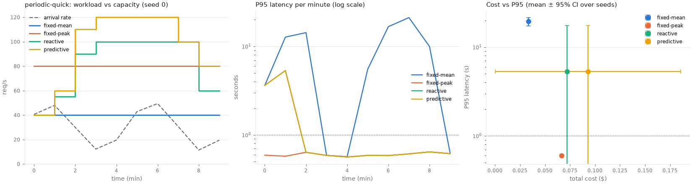
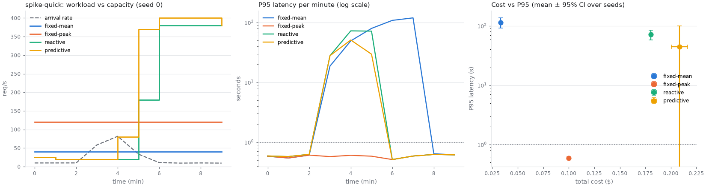

# Benchmark results

Generated by `python experiments/run.py`. Values are mean ± 95% confidence half-width
(Student t) across seeds. Each seed generates one trace shared by every strategy.

## periodic-quick

Sinusoidal traffic over 10 minutes.
Seeds: [0, 1].

| Strategy | P95 latency (s) | P95 incl. backlog (s) | SLA violations (%) | Cost ($) | Utilisation | Mean replicas | Unfinished | Scale events |
|---|---|---|---|---|---|---|---|---|
| fixed-mean | 19.441 ± 2.064 | 19.44 ± 2.06 | 67.96 ± 16.72 | 0.033 ± 0.000 | 0.757 ± 0.088 | 2.00 ± 0.00 | 4 ± 6 | 0.0 ± 0.0 |
| fixed-peak | 0.598 ± 0.021 | 0.60 ± 0.02 | 0.68 ± 0.39 | 0.067 ± 0.000 | 0.379 ± 0.044 | 4.00 ± 0.00 | 4 ± 6 | 0.0 ± 0.0 |
| reactive | 5.285 ± 12.283 | 5.28 ± 12.28 | 19.26 ± 41.91 | 0.072 ± 0.000 | 0.376 ± 0.044 | 4.33 ± 0.00 | 4 ± 6 | 3.0 ± 0.0 |
| predictive | 5.285 ± 12.283 | 5.28 ± 12.28 | 19.20 ± 41.17 | 0.093 ± 0.093 | 0.296 ± 0.250 | 5.59 ± 5.56 | 4 ± 6 | 4.0 ± 0.0 |

## spike-quick

10 req/s with a 2 minute spike to 80 req/s over 10 minutes.
Seeds: [0, 1].

| Strategy | P95 latency (s) | P95 incl. backlog (s) | SLA violations (%) | Cost ($) | Utilisation | Mean replicas | Unfinished | Scale events |
|---|---|---|---|---|---|---|---|---|
| fixed-mean | 114.574 ± 21.898 | 114.57 ± 21.87 | 77.87 ± 0.77 | 0.033 ± 0.000 | 0.607 ± 0.114 | 2.00 ± 0.00 | 2 ± 13 | 0.0 ± 0.0 |
| fixed-peak | 0.593 ± 0.033 | 0.59 ± 0.03 | 0.68 ± 0.36 | 0.100 ± 0.000 | 0.202 ± 0.038 | 6.00 ± 0.00 | 2 ± 13 | 0.0 ± 0.0 |
| reactive | 71.400 ± 13.060 | 71.40 ± 13.05 | 68.45 ± 5.18 | 0.180 ± 0.000 | 0.135 ± 0.025 | 10.83 ± 0.00 | 2 ± 13 | 3.0 ± 0.0 |
| predictive | 44.349 ± 55.379 | 44.35 ± 55.38 | 59.31 ± 16.59 | 0.209 ± 0.008 | 0.114 ± 0.016 | 12.51 ± 0.47 | 2 ± 13 | 5.5 ± 6.4 |

