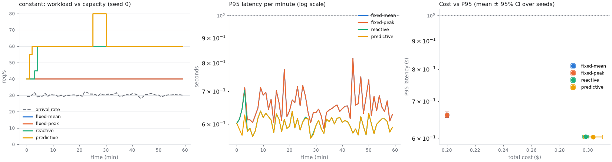
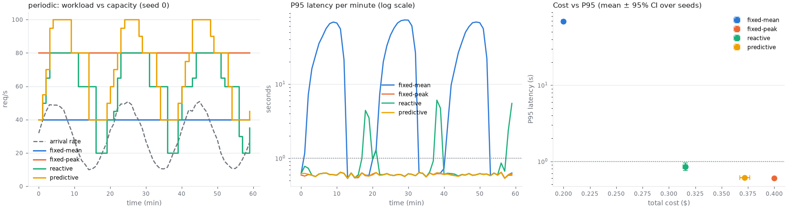
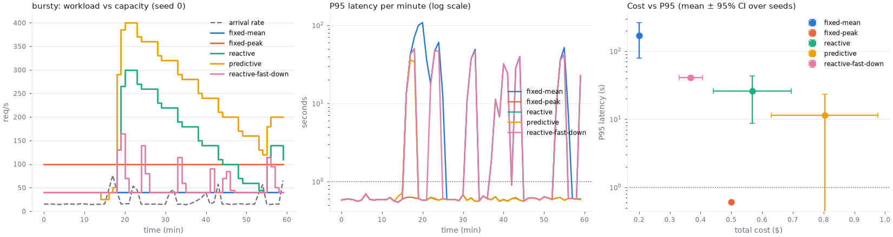
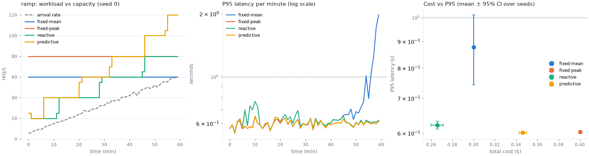
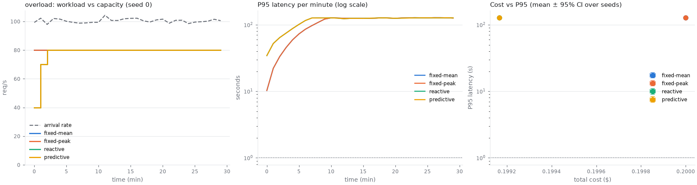

# Benchmark results

Generated by `python experiments/run.py`. Values are mean ± 95% confidence half-width
(Student t) across seeds. Each seed generates one trace shared by every strategy.

## constant

Steady Poisson traffic at 30 req/s.
Seeds: [0, 1, 2, 3, 4].

| Strategy | P95 latency (s) | P95 incl. backlog (s) | SLA violations (%) | Cost ($) | Utilisation | Mean replicas | Unfinished | Scale events |
|---|---|---|---|---|---|---|---|---|
| fixed-mean | 0.662 ± 0.007 | 0.66 ± 0.01 | 0.94 ± 0.05 | 0.200 ± 0.000 | 0.754 ± 0.002 | 2.00 ± 0.00 | 8 ± 5 | 0.0 ± 0.0 |
| fixed-peak | 0.662 ± 0.007 | 0.66 ± 0.01 | 0.94 ± 0.05 | 0.200 ± 0.000 | 0.754 ± 0.002 | 2.00 ± 0.00 | 8 ± 5 | 0.0 ± 0.0 |
| reactive | 0.604 ± 0.003 | 0.60 ± 0.00 | 0.69 ± 0.03 | 0.298 ± 0.002 | 0.508 ± 0.004 | 2.98 ± 0.02 | 7 ± 4 | 1.0 ± 0.0 |
| predictive | 0.603 ± 0.003 | 0.60 ± 0.00 | 0.69 ± 0.02 | 0.304 ± 0.007 | 0.501 ± 0.010 | 3.04 ± 0.07 | 7 ± 4 | 1.8 ± 1.4 |

## periodic

Sinusoidal traffic, 30 ± 20 req/s with a 20 minute period.
Seeds: [0, 1, 2, 3, 4].

| Strategy | P95 latency (s) | P95 incl. backlog (s) | SLA violations (%) | Cost ($) | Utilisation | Mean replicas | Unfinished | Scale events |
|---|---|---|---|---|---|---|---|---|
| fixed-mean | 68.422 ± 3.089 | 68.42 ± 3.09 | 69.36 ± 0.97 | 0.200 ± 0.000 | 0.754 ± 0.003 | 2.00 ± 0.00 | 7 ± 6 | 0.0 ± 0.0 |
| fixed-peak | 0.601 ± 0.002 | 0.60 ± 0.00 | 0.68 ± 0.02 | 0.400 ± 0.000 | 0.377 ± 0.001 | 4.00 ± 0.00 | 6 ± 5 | 0.0 ± 0.0 |
| reactive | 0.854 ± 0.099 | 0.85 ± 0.10 | 3.67 ± 1.07 | 0.316 ± 0.002 | 0.504 ± 0.003 | 3.16 ± 0.02 | 7 ± 6 | 15.8 ± 0.6 |
| predictive | 0.612 ± 0.010 | 0.61 ± 0.01 | 0.74 ± 0.09 | 0.372 ± 0.005 | 0.425 ± 0.006 | 3.72 ± 0.05 | 6 ± 5 | 16.2 ± 0.6 |

## bursty

MMPP: 15 req/s with bursts to 75 req/s (mean 60 s bursts every ~5 min).
Seeds: [0, 1, 2, 3, 4].

| Strategy | P95 latency (s) | P95 incl. backlog (s) | SLA violations (%) | Cost ($) | Utilisation | Mean replicas | Unfinished | Scale events |
|---|---|---|---|---|---|---|---|---|
| fixed-mean | 170.476 ± 91.178 | 170.47 ± 91.91 | 64.89 ± 12.10 | 0.200 ± 0.000 | 0.632 ± 0.085 | 2.00 ± 0.00 | 1450 ± 2115 | 0.0 ± 0.0 |
| fixed-peak | 0.604 ± 0.002 | 0.60 ± 0.00 | 0.70 ± 0.02 | 0.500 ± 0.000 | 0.260 ± 0.033 | 5.00 ± 0.00 | 2 ± 1 | 0.0 ± 0.0 |
| reactive | 25.775 ± 17.035 | 25.78 ± 17.03 | 15.92 ± 7.07 | 0.568 ± 0.127 | 0.250 ± 0.083 | 5.68 ± 1.27 | 2 ± 1 | 10.4 ± 1.1 |
| predictive | 11.375 ± 11.926 | 11.37 ± 11.93 | 7.98 ± 3.60 | 0.804 ± 0.173 | 0.176 ± 0.056 | 8.04 ± 1.73 | 2 ± 1 | 13.8 ± 1.6 |
| reactive-fast-down | 40.820 ± 2.651 | 40.80 ± 2.63 | 42.35 ± 7.17 | 0.368 ± 0.039 | 0.437 ± 0.015 | 3.68 ± 0.39 | 334 ± 923 | 19.6 ± 3.6 |

## spike

10 req/s with a single 5 minute spike to 80 req/s at t = 20 min.
Seeds: [0, 1, 2, 3, 4].

| Strategy | P95 latency (s) | P95 incl. backlog (s) | SLA violations (%) | Cost ($) | Utilisation | Mean replicas | Unfinished | Scale events |
|---|---|---|---|---|---|---|---|---|
| fixed-mean | 245.326 ± 4.331 | 245.32 ± 4.33 | 48.18 ± 0.43 | 0.200 ± 0.000 | 0.384 ± 0.002 | 2.00 ± 0.00 | 3 ± 1 | 0.0 ± 0.0 |
| fixed-peak | 0.599 ± 0.002 | 0.60 ± 0.00 | 0.70 ± 0.04 | 0.600 ± 0.000 | 0.133 ± 0.001 | 6.00 ± 0.00 | 3 ± 1 | 0.0 ± 0.0 |
| reactive | 57.649 ± 4.929 | 57.65 ± 4.93 | 22.97 ± 1.05 | 0.775 ± 0.082 | 0.107 ± 0.012 | 7.75 ± 0.82 | 3 ± 1 | 10.2 ± 0.6 |
| predictive | 30.117 ± 12.904 | 30.12 ± 12.90 | 15.65 ± 1.52 | 0.913 ± 0.038 | 0.091 ± 0.004 | 9.13 ± 0.38 | 3 ± 1 | 14.8 ± 1.4 |
| reactive-fast-down | 57.649 ± 4.929 | 57.65 ± 4.93 | 23.01 ± 1.04 | 0.200 ± 0.002 | 0.464 ± 0.003 | 2.00 ± 0.02 | 3 ± 2 | 6.2 ± 0.6 |

## ramp

Load growing linearly from 5 to 60 req/s over the hour.
Seeds: [0, 1, 2, 3, 4].

| Strategy | P95 latency (s) | P95 incl. backlog (s) | SLA violations (%) | Cost ($) | Utilisation | Mean replicas | Unfinished | Scale events |
|---|---|---|---|---|---|---|---|---|
| fixed-mean | 0.878 ± 0.135 | 0.88 ± 0.13 | 3.49 ± 1.69 | 0.300 ± 0.000 | 0.544 ± 0.001 | 3.00 ± 0.00 | 54 ± 25 | 0.0 ± 0.0 |
| fixed-peak | 0.603 ± 0.002 | 0.60 ± 0.00 | 0.69 ± 0.02 | 0.400 ± 0.000 | 0.408 ± 0.001 | 4.00 ± 0.00 | 17 ± 7 | 0.0 ± 0.0 |
| reactive | 0.622 ± 0.011 | 0.62 ± 0.01 | 0.77 ± 0.09 | 0.266 ± 0.006 | 0.629 ± 0.010 | 2.66 ± 0.06 | 16 ± 8 | 4.4 ± 0.7 |
| predictive | 0.602 ± 0.002 | 0.60 ± 0.00 | 0.68 ± 0.02 | 0.346 ± 0.004 | 0.483 ± 0.005 | 3.46 ± 0.04 | 14 ± 4 | 6.0 ± 0.0 |

## overload

100 req/s against a cluster capped at 4 servers (80 req/s nominal capacity).
Seeds: [0, 1, 2, 3, 4].

| Strategy | P95 latency (s) | P95 incl. backlog (s) | SLA violations (%) | Cost ($) | Utilisation | Mean replicas | Unfinished | Scale events |
|---|---|---|---|---|---|---|---|---|
| fixed-mean | 127.113 ± 0.232 | 127.08 ± 0.23 | 99.81 ± 0.04 | 0.200 ± 0.000 | 1.000 ± 0.000 | 4.00 ± 0.00 | 10012 ± 6 | 0.0 ± 0.0 |
| fixed-peak | 127.113 ± 0.232 | 127.08 ± 0.23 | 99.81 ± 0.04 | 0.200 ± 0.000 | 1.000 ± 0.000 | 4.00 ± 0.00 | 10012 ± 6 | 0.0 ± 0.0 |
| reactive | 127.142 ± 0.672 | 127.10 ± 0.64 | 99.97 ± 0.01 | 0.199 ± 0.000 | 1.000 ± 0.000 | 3.98 ± 0.00 | 10012 ± 3 | 1.0 ± 0.0 |
| predictive | 127.142 ± 0.672 | 127.10 ± 0.64 | 99.97 ± 0.01 | 0.199 ± 0.000 | 1.000 ± 0.000 | 3.98 ± 0.00 | 10012 ± 3 | 1.0 ± 0.0 |

